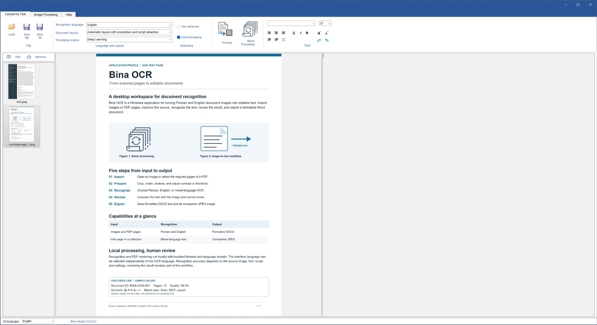
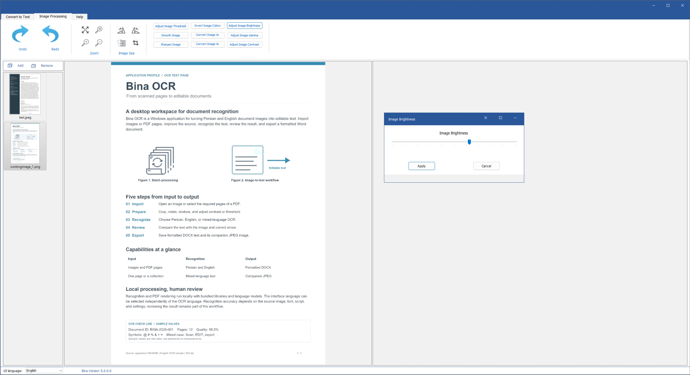

# Bina OCR

**A bilingual document workspace, modernized from .NET Framework 4.5 to .NET 10.**

Bina turns Persian and English document images into editable, formatted Word documents. Import images or PDF pages, prepare the scan, recognize text locally, review the result, and export DOCX with a companion image—all in one Windows desktop application.

This repository also documents the engineering behind maintaining a native-backed desktop product: separating application services from UI code, coordinating asynchronous work with a shared native engine, managing bitmap lifetimes, and preserving bilingual document formatting.

**C# · .NET 10 · WinForms · Native interop · Tesseract integration · Open XML SDK · English/Persian**

[Engineering case study](docs/engineering.md) · [Build and validation](docs/development.md) · [Change history](CHANGELOG.md) · [Contributing](CONTRIBUTING.md)

## The application



| Workflow | Capabilities |
| --- | --- |
| Import | Multiple images, complete PDFs, or selected PDF pages; thumbnail navigation. |
| Prepare | Crop, rotate, deskew, sharpen, smooth, invert, and adjust brightness, gamma, contrast, or threshold; preview adjustments and undo/redo edits. |
| Recognize | Local Persian, English, and mixed-language models; page segmentation options; single-page and sequential batch processing. |
| Review | Per-image text and RTF state; font, color, emphasis, paragraph alignment, bullets, indentation, and text direction. |
| Export | Formatted DOCX plus JPEG; numbered filenames and exclusive file creation protect existing output. |
| Localize | English/Persian labels and LTR/RTL layouts; changing interface language selects the matching OCR language, which can also be changed manually. |



Recognition and PDF rendering run locally. The bundled recognition assets include a custom model integrated through the Tesseract-based pipeline. Export preserves recognized text and supported editor formatting. Recognition quality depends on the scan, script, font, and settings; human review remains part of the workflow.

## Engineering highlights

| Engineering problem | Implementation | Evidence |
| --- | --- | --- |
| Modernize an existing desktop product | SDK-style .NET 10 projects, shared build settings, PackageReference, and updated dynamic interop assembly creation. | [Migration commit](https://github.com/Nigje/DSP.Kana.Ocr/commit/5cebddfdda32ae55ead39946e792bc7849fa27d1), [build settings](Directory.Build.props) |
| Coordinate a shared native engine | Injected `IOcrService`, immutable operation options, owned bitmap snapshots, and a process-wide asynchronous gate. Cancellation waits for an active native page before releasing its resources. | [OcrService](DSP.Bina.Ocr.DesktopApplication.V3/Services/OcrService.cs), [workflow regressions](tests/SmokeTests/RefactoringTests.cs) |
| Make image lifetimes explicit | Disposable image entities, bounded undo/redo history, detached imports, and independent thumbnails. | [ImageEntity](DSP.Bina.Ocr.DesktopApplication.V3/Model/ImageEntity.cs), [ImageImportService](DSP.Bina.Ocr.DesktopApplication.V3/Services/ImageImportService.cs) |
| Preserve user work through export | Separate document snapshots from WinForms; generate bilingual DOCX with Open XML SDK and validate its schema and round-trip content. | [Export service](DSP.Bina.Ocr.DesktopApplication.V3/Services/DocumentExportService.cs), [smoke suite](tests/SmokeTests/Program.cs) |
| Support two writing directions | Resource-based localization, directional layout, batched repainting, and restoration of RTF and selection when recognition direction changes. | [Localization](DSP.Bina.Ocr.DesktopApplication.V3/Forms/MainForm.Localization.cs), [layout](DSP.Bina.Ocr.DesktopApplication.V3/Forms/MainForm.Layout.cs) |

The [engineering case study](docs/engineering.md) explains the decisions, tradeoffs, and corresponding commits. It is the suggested starting point for a technical review.

## Try it

Use Windows with the .NET 10 SDK. For IDE development, use Visual Studio 2026 with the .NET desktop development workload. `global.json` selects the .NET 10 SDK family.

```powershell
dotnet restore DSP.Khana.Ocr.sln
dotnet run --project DSP.Bina.Ocr.DesktopApplication.V3 -c Release
```

Load a document, prepare the image, choose the recognition settings, and run recognition. Review the text before exporting. Edits and image history are held within the current session.

## Verify the behavior

From PowerShell on Windows:

```powershell
./scripts/Verify.ps1
```

The script restores and builds the smoke-test project and all six production projects, then runs the integration suite. It uses a separate, ignored output folder so an open application does not lock its binaries. The same command is configured in the [Windows CI workflow](.github/workflows/windows-verification.yml); a hosted run is required to establish CI status.

The suite exercises native OCR and PDF rendering, DOCX schema validation and round trips, bitmap disposal, cancellation and failure recovery, editor persistence, and live bilingual forms. These checks establish functional behavior; they do not measure OCR accuracy, throughput, or memory consumption. See [development documentation](docs/development.md) for focused checks and runtime requirements.

## Project history and scope

The project originated as a .NET Framework 4.5 desktop application around 2018. The Git history in this standalone repository begins with an imported application on October 1, 2026; it records the subsequent modernization, service extraction, export replacement, and UI fixes. Earlier development is background context rather than history preserved here.

The application integrates substantial upstream work, including Charles Weld's Tesseract .NET wrapper, Andrey Akinshin's InteropDotNet, and Open XML SDK. Their authorship and licenses are retained in [THIRD-PARTY-NOTICES.md](THIRD-PARTY-NOTICES.md), [LICENSES](LICENSES), and the [historical source comparison](docs/open-source-audit/README.md).

The repository has no selected license for independently authored application code. The existing notices cover only part of the dependency inventory; native binaries, models, PDF integration, and other assets still need release review. See [release readiness](docs/development.md#release-readiness) before distributing a complete source or binary release.

Current constraints include Windows-only execution, session-only document state, native x86/x64 dependencies, and cancellation at native page boundaries. These boundaries and deployment requirements are documented in the [developer guide](docs/development.md).
