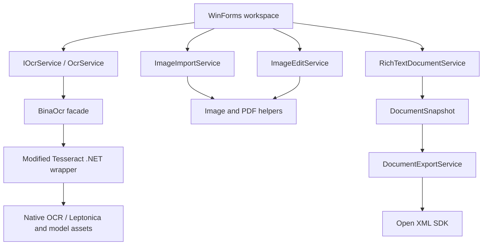

# Engineering case study: modernizing Bina OCR

Bina OCR combines image preparation, native text recognition, bilingual editing, and Word export in a Windows application. Its modernization illustrates evolving an existing product while retaining compatibility with native dependencies and user workflows.

This guide focuses on work visible in the standalone repository's Git history. Application engineering and upstream library authorship are identified separately.

## System boundaries

The six production projects comprise the desktop application, image tools, application OCR facade, modified managed OCR wrapper, post-processing, and ImageListView. The separate smoke-test executable references the desktop and exercises the resulting dependency graph.

`MainForm` retains UI orchestration. Services own import, image edits, recognition, text capture, export, and error reporting. This is an incremental separation of responsibilities: the application still uses WinForms and existing native assets, while critical behavior can be tested outside UI event handlers.

## 1. Migrate the runtime while preserving integration contracts

The migration converted legacy projects to SDK-style .NET 10 builds, centralized shared settings, replaced package-cache references with PackageReference, and updated dynamic interop assembly creation. Existing assembly identities and explicit resource lists were retained to reduce disruption at integration boundaries.

The post-processing project targets `net10.0`; Windows-dependent projects target `net10.0-windows`. Windows targeting reflects actual dependencies on WinForms, System.Drawing, and bundled native binaries.

Evidence: [migration commit 5cebddf](https://github.com/Nigje/DSP.Kana.Ocr/commit/5cebddfdda32ae55ead39946e792bc7849fa27d1), [Directory.Build.props](../Directory.Build.props), [global.json](../global.json).

## 2. Coordinate native work and cancellation explicitly

A recognition operation captures its language, engine, segmentation, and post-processing options before starting. `OcrService` clones the input bitmap and waits on a static `SemaphoreSlim`, serializing native calls across service instances and windows.

The native API cannot interrupt an active page. Canceling an operation stops queued work and later pages, allows the current call to finish, and rejects its result before it can replace edited text. The snapshot and gate remain owned until that call completes. Form closure requests cancellation and defers closing until the operation unwinds.

This trades parallel recognition throughput for safe use of a shared engine. Cancellation is cooperative at the managed boundary; its latency depends on the active native call.

Evidence: [service extraction commit e3d7d82](https://github.com/Nigje/DSP.Kana.Ocr/commit/e3d7d826f53c25c4d700ff4c41b4c2d6c78a5c09), [OcrService](../DSP.Bina.Ocr.DesktopApplication.V3/Services/OcrService.cs), [MainForm.Workflows](../DSP.Bina.Ocr.DesktopApplication.V3/Forms/MainForm.Workflows.cs).

The deterministic regressions inject a recognition delegate and control completion with `TaskCompletionSource`. They exercise serialization, queued and active cancellation, failure recovery, control restoration, and closing during recognition without relying on native engine timing.

## 3. Model ownership of unmanaged image resources

`ImageEntity` owns its current bitmap and two bounded history stacks. A committed edit clones the new image, moves the previous image into undo history, and disposes invalidated redo entries. History eviction and entity disposal release owned images.

Imports are detached copies, allowing source files to be closed immediately. Thumbnail images have independent ownership. Adjustment previews are disposed when replaced or when a dialog closes, and temporary import files belong to a session directory.

The twenty-entry bound limits history depth, not total memory. Large images can still be expensive; this implementation has no byte-based memory budget. The tests assert disposal and source-file unlocking rather than a measured memory reduction.

Evidence: [ImageEntity](../DSP.Bina.Ocr.DesktopApplication.V3/Model/ImageEntity.cs), [FixedSizeStack](../DSP.Bina.Ocr.DesktopApplication.V3/Model/FixedSizeStack.cs), [ImageImportService](../DSP.Bina.Ocr.DesktopApplication.V3/Services/ImageImportService.cs), [ownership regressions](../tests/SmokeTests/RefactoringTests.cs).

## 4. Export the edited document, with explicit failure behavior

`RichTextDocumentService` captures editor content into paragraph and text-run snapshots. `DocumentExportService` consumes those snapshots to generate DOCX through Open XML SDK, including complex-script font properties and explicit paragraph direction for Persian content. The exporter does not depend on a live editor control.

Filename selection checks both the DOCX and JPEG destinations. `FileMode.CreateNew` protects against a competing writer creating a file after the initial check. Failure cleanup removes only files created by that export attempt.

The pair is not a filesystem transaction: abrupt process termination can leave partial output. Within handled failures, the implementation tracks ownership and preserves pre-existing destinations. Tests cover numbered collisions, existing-file preservation, bilingual formatting, whitespace, and Open XML schema validation.

Evidence: [Open XML replacement commit 1b842d6](https://github.com/Nigje/DSP.Kana.Ocr/commit/1b842d604c61e1166ef89922c510ab02b7b74cda), [text capture](../DSP.Bina.Ocr.DesktopApplication.V3/Services/RichTextDocumentService.cs), [export](../DSP.Bina.Ocr.DesktopApplication.V3/Services/DocumentExportService.cs).

## 5. Treat localization as application behavior

English/Persian support includes strongly typed resources, directional layout, translated dialogs, and recognition defaults. Changing the interface language selects the corresponding OCR model; users can subsequently choose Persian, English, or mixed recognition manually.

Switching direction can recreate native control handles. The implementation keeps the main window handle alive, batches layout and repaint work, and restores the editor's RTF and selection when recognition direction changes. Tests repeatedly switch languages while asserting document preservation, window lifetime, and layout after resizing. They also inject a translation failure to check that the redraw guard is released.

Evidence: [window-refresh fix 29374bc](https://github.com/Nigje/DSP.Kana.Ocr/commit/29374bce9ea5f25949dc3c09e5aa3fb26c9a1ed2), [recognition-language alignment 2909e5d](https://github.com/Nigje/DSP.Kana.Ocr/commit/2909e5d366c42480cc648cdbcd46ae37fc5ceb58), [localization implementation](../DSP.Bina.Ocr.DesktopApplication.V3/Forms/MainForm.Localization.cs), [form regressions](../tests/SmokeTests/Program.cs).

## Validation strategy

| Boundary | Checks | What they establish |
| --- | --- | --- |
| Managed workflow | Injected OCR completion, cancellation, failures, shutdown, and image ownership | Deterministic lifecycle and state behavior |
| Document output | Production export, SDK reload, XML assertions, schema validation, filename collisions | Structural validity and preservation of supported formatting |
| Native integration | Bundled models, synchronous/asynchronous recognition, post-processing, PDF rendering | Functional compatibility with the bundled runtime assets |
| WinForms | Production forms, resource lookups, repeated language switching, dialogs, resizing | UI initialization and selected interaction regressions |

The test project is an executable integration harness with an STA entry point and explicit failure exit codes. Run it with `dotnet run`, or use [scripts/Verify.ps1](../scripts/Verify.ps1); `dotnet test` does not execute these checks. The [Windows workflow](../.github/workflows/windows-verification.yml) invokes the same script.

Native facade verification uses a host-configurable extraction root set to a unique temporary directory before initialization. This keeps test assets separate from the desktop application's model cache. The [developer guide](development.md#local-verification-recorded-october-17-2026) records the completed local verification run.

There is no published accuracy dataset, performance benchmark, or coverage percentage. Native smoke checks and lifecycle regressions support narrower, reproducible claims.

## A guided Git review

| Commit | Review focus |
| --- | --- |
| [881e090](https://github.com/Nigje/DSP.Kana.Ocr/commit/881e090) | Imported standalone baseline; the beginning of this repository's recorded history. |
| [5cebddf](https://github.com/Nigje/DSP.Kana.Ocr/commit/5cebddfdda32ae55ead39946e792bc7849fa27d1) | Runtime migration, build configuration, and compatibility changes. |
| [e3d7d82](https://github.com/Nigje/DSP.Kana.Ocr/commit/e3d7d826f53c25c4d700ff4c41b4c2d6c78a5c09) | Service boundaries, resource ownership, cancellation, and regression checks. |
| [413e10d](https://github.com/Nigje/DSP.Kana.Ocr/commit/413e10d) | Restored upstream identities, notices, and attribution records. |
| [1b842d6](https://github.com/Nigje/DSP.Kana.Ocr/commit/1b842d604c61e1166ef89922c510ab02b7b74cda) | Document export replacement and schema-level validation. |
| [29374bc](https://github.com/Nigje/DSP.Kana.Ocr/commit/29374bce9ea5f25949dc3c09e5aa3fb26c9a1ed2) | UI lifetime and repaint behavior during localization. |
| [2909e5d](https://github.com/Nigje/DSP.Kana.Ocr/commit/2909e5d366c42480cc648cdbcd46ae37fc5ceb58) | Recognition defaults synchronized with interface language. |

The recorded commits use the author name **Nigje**. The initial import includes pre-existing application and third-party code; commit authorship alone does not establish original authorship of every imported component. The [source comparison](open-source-audit/README.md) documents upstream provenance and its limits.

## Portfolio summary

The repository supports the following descriptions of the engineering work:

- Modernized a Windows OCR application from .NET Framework 4.5 to .NET 10, retaining native OCR/PDF integration while moving to SDK-style projects and PackageReference.
- Extracted recognition, import, image editing, and document export services; implemented serialized native execution, cancellation boundaries, and explicit bitmap ownership.
- Implemented formatted bilingual DOCX export with Open XML SDK, schema and round-trip checks, and collision-safe output creation.
- Developed English/Persian UI behavior with LTR/RTL layout and regression checks for editor preservation, cancellation, failure recovery, and form lifetime.

Each statement can be traced to implementation and commits above. The next engineering steps are dependency/license inventory completion, durable session storage, native asset deployment improvements, and measured OCR evaluation.
